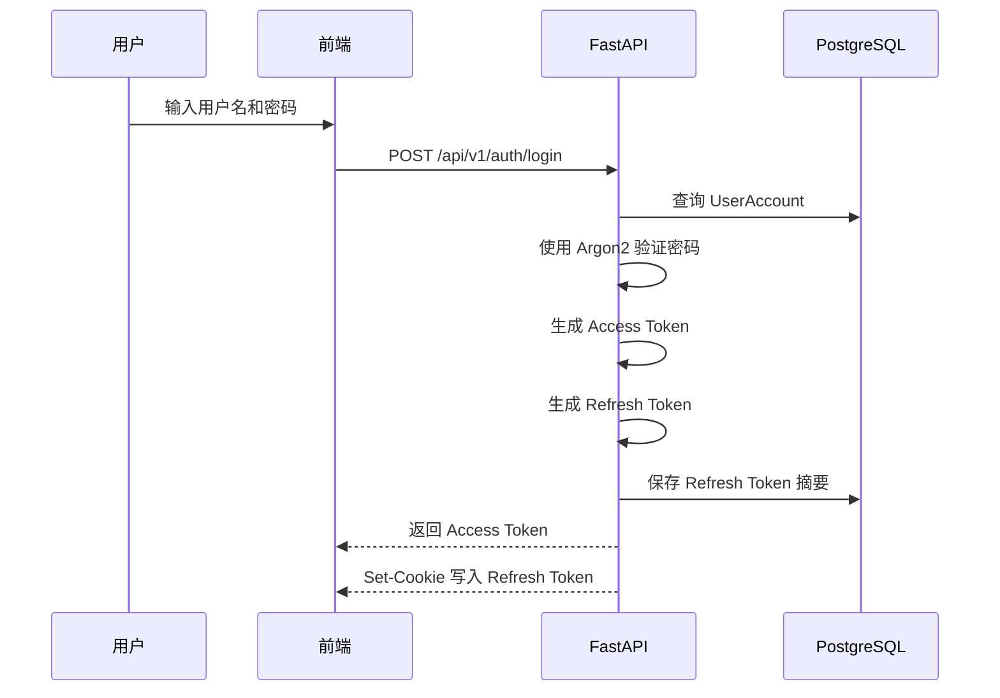
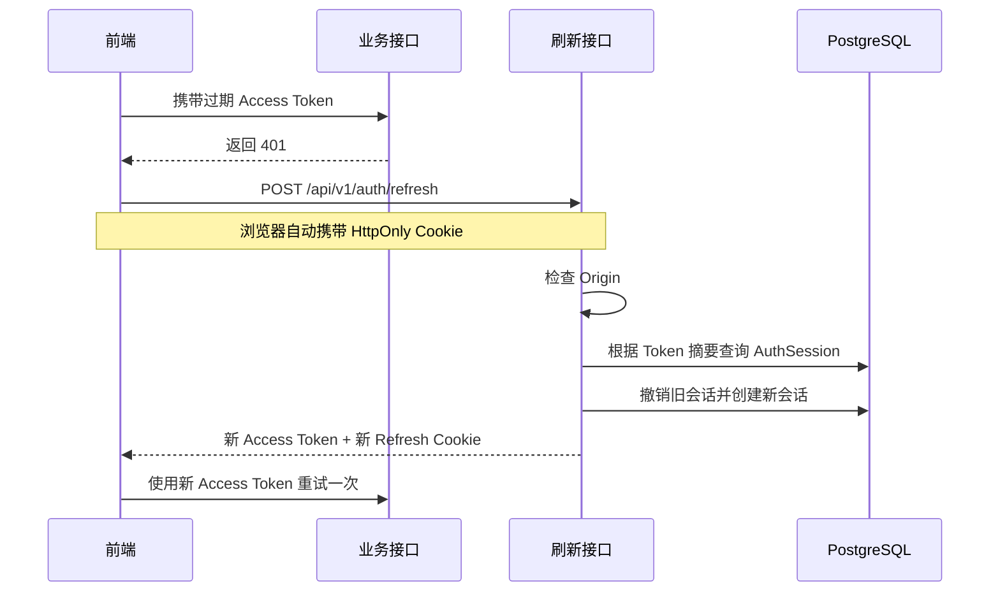

# JWT 与登录会话安全笔记

> 适用项目：MallMate 电商客服售后 Agent
> 目标：理解 JWT、Access Token、Refresh Token、Cookie 和服务端 Session 如何配合。

## 1. 整体认识

可以把登录系统理解成酒店：

| 概念 | 类比 | 作用 |
|---|---|---|
| 密码 | 办理入住时出示的身份证 | 第一次登录时证明身份 |
| Access Token | 短期房卡 | 访问订单、售后、聊天等接口 |
| Refresh Token | 续房凭证 | Access Token 过期后换取新 Token |
| AuthSession | 酒店前台的入住记录 | 记录刷新会话、过期和撤销状态 |
| Cookie | 浏览器保管的安全信封 | 自动携带 Refresh Token |

MallMate 使用的是混合认证方案：

```text
短期 JWT Access Token
+ HttpOnly Cookie 中的随机 Refresh Token
+ PostgreSQL 中的 AuthSession
```

## 2. 认证与授权

- **认证 Authentication**：确认“你是谁”。
- **授权 Authorization**：确认“你能做什么”。

项目中的授权分为两层：

1. **角色权限**：顾客、客服、管理员可以进入不同接口。
2. **资源归属**：顾客只能查询自己的订单、物流和售后单。

不能相信前端传入的 `customer_id`。后端必须从已经验证的账号生成 `Principal`，再找到对应的 Customer。

## 3. JWT 基础

JWT 是服务端签发的短期身份凭证，结构为：

```text
Header.Payload.Signature
```

### 3.1 Header

描述 Token 类型和签名算法：

```json
{
  "typ": "JWT",
  "alg": "HS256"
}
```

### 3.2 Payload

保存身份声明：

| 字段 | 含义 |
|---|---|
| `sub` | Token 属于哪个账号 |
| `iss` | 谁签发了 Token |
| `aud` | Token 允许哪个系统使用 |
| `iat` | 签发时间 |
| `exp` | 过期时间 |
| `jti` | Token 唯一编号 |

Payload 只是 Base64URL 编码，并没有加密。不要在里面保存密码、API Key 或其他隐私数据。

### 3.3 Signature

HS256 签名过程可以简化为：

```text
HMAC-SHA256(
    JWT_SECRET,
    Base64URL(Header) + "." + Base64URL(Payload)
)
```

攻击者修改 Payload 后无法生成正确签名，后端验证时会拒绝该 Token。

JWT 能证明：

- 内容没有被修改。
- Token 由持有 JWT Secret 的服务端签发。

JWT 不能保证：

- Payload 保密。
- Token 被盗后无法使用。
- 用户一定有权访问某笔订单。

因此还需要 HTTPS、短有效期和资源权限检查。

## 4. Access Token 与 Refresh Token

| 对比 | Access Token | Refresh Token |
|---|---|---|
| 作用 | 访问业务接口 | 换取新 Access Token |
| 当前有效期 | 约 15 分钟 | 约 7 天 |
| 保存位置 | 前端内存 | HttpOnly Cookie |
| 服务端保存 | 通常不保存原文 | 只保存 SHA-256 摘要 |
| 使用位置 | `Authorization` Header | 刷新、退出接口 |

### Access Token

前端调用接口时主动添加：

```http
Authorization: Bearer <access_token>
```

它有效期短，可以限制泄露后的影响时间。

### Refresh Token

Refresh Token 是高强度随机字符串，只用于刷新会话。数据库保存：

```text
SHA-256(refresh_token)
```

数据库泄露后，攻击者不能直接把摘要当作 Refresh Token 使用。

## 5. Cookie 与服务端 Session

Refresh Token 放在 Cookie 中，浏览器会自动携带它。

重要属性：

| 属性 | 作用 |
|---|---|
| `HttpOnly` | JavaScript 不能直接读取 Cookie |
| `Secure` | 只通过 HTTPS 发送，生产环境必须开启 |
| `SameSite` | 限制跨站请求自动携带 Cookie |

数据库中的 `AuthSession` 保存刷新会话状态，例如：

- 属于哪个账号。
- Token 摘要。
- 过期时间。
- 是否已经撤销。

所以当前方案可以理解为：

```text
Access JWT 负责短期访问
Refresh Cookie + AuthSession 负责长期登录和撤销
```

## 6. 登录流程



步骤：

1. 前端提交用户名和密码。
2. Pydantic 校验输入格式。
3. 后端查询 `UserAccount`。
4. Argon2 验证密码哈希。
5. 生成约 15 分钟有效的 Access Token。
6. 生成随机 Refresh Token。
7. 数据库保存 Refresh Token 摘要。
8. Access Token 返回前端内存。
9. Refresh Token 写入 HttpOnly Cookie。

## 7. 访问业务接口

以查询订单为例：

```text
前端携带 Access Token
  → 后端验证 JWT 签名
  → 检查 exp、iss、aud、sub 等声明
  → 查询账号是否仍然启用
  → 构造 Principal
  → 找到账号对应的 Customer
  → 检查订单是否属于该 Customer
  → 返回订单
```

JWT 只证明请求属于哪个账号。订单归属仍然必须由 Service 和 Repository 检查。

## 8. Access Token 过期后的刷新流程



Refresh Token 每次成功使用后都会轮换：

```text
Refresh A 使用成功 → A 失效 → 生成 Refresh B
Refresh B 使用成功 → B 失效 → 生成 Refresh C
```

旧 Refresh Token 再次使用时会被拒绝。

## 9. 页面刷新后的会话恢复

页面刷新后，内存中的 Access Token 会消失，但 HttpOnly Cookie 仍然存在：

```text
页面重新加载
  → 调用刷新接口
  → 浏览器自动携带 Refresh Cookie
  → 后端检查 AuthSession
  → 返回新 Access Token
  → 请求当前用户信息
  → 恢复登录状态
```

前端不需要，也不能直接读取 HttpOnly Refresh Cookie。

## 10. 退出登录流程

```text
前端使旧请求失效
  → 调用 POST /api/v1/auth/logout
  → 后端撤销 AuthSession
  → 后端删除 Refresh Cookie
  → 前端清除 Access Token 和用户信息
```

退出后，已经签发的 Access Token 没有单独黑名单，理论上仍可能使用到自然过期，最长约 15 分钟。因此 Access Token 必须保持短期有效。

## 11. Token 失效流程

### Access Token 过期

```text
业务接口返回 401
  → 前端尝试刷新一次
  → 刷新成功：重试原请求
  → 刷新失败：回到登录页
```

### Refresh Token 过期或已撤销

```text
刷新接口拒绝请求
  → 删除或忽略无效 Cookie
  → 清除前端 Access Token
  → 用户重新登录
```

### JWT 签名错误

```text
签名校验失败
  → 不信任 Payload
  → 拒绝业务请求
```

### 账号被禁用

```text
JWT 可能尚未过期
  → 后端重新查询账号状态
  → 发现账号已禁用
  → 拒绝请求
```

## 12. 安全机制对应的风险

| 风险 | 防护机制 |
|---|---|
| 修改 JWT 中的用户或角色 | JWT 签名校验 |
| Access Token 泄露 | 约 15 分钟短有效期 |
| JavaScript 读取 Refresh Token | HttpOnly Cookie |
| 网络窃听 | 生产环境使用 HTTPS |
| 数据库泄露 Refresh Token | 只保存 SHA-256 摘要 |
| Refresh Token 重复使用 | 轮换并撤销旧会话 |
| 跨站利用 Cookie | SameSite 与 Origin 校验 |
| 修改 `customer_id` 冒充他人 | 服务端 Principal 与账号关联 |
| 修改订单号访问他人订单 | Repository 增加资源归属条件 |

## 13. 对应项目代码

| 内容 | 文件 |
|---|---|
| 密码、JWT、Token 摘要 | `backend/app/core/security.py` |
| 登录、刷新、退出接口 | `backend/app/api/routes/auth.py` |
| 认证业务流程 | `backend/app/services/auth.py` |
| 用户与会话查询 | `backend/app/repositories/users.py` |
| 当前用户依赖与角色检查 | `backend/app/api/dependencies.py` |
| UserAccount、AuthSession | `backend/app/models.py` |
| 前端 Token 管理 | `frontend/lib/api-client.ts` |
| 安全配置 | `backend/app/core/config.py` |

推荐阅读顺序：

```text
routes/auth.py
  → services/auth.py
  → repositories/users.py
  → models.py
  → core/security.py
  → api/dependencies.py
  → frontend/lib/api-client.ts
```

## 14. 当前能力边界

- 还没有登录和刷新接口限流。
- 还没有完整的 Refresh Token family 重放检测。
- 还没有 JWT 签名密钥轮换。
- 多标签页同时刷新仍需要进一步协调。
- 管理员 MFA 和客服工单范围授权尚未实现。

JWT 不是单独保证安全的工具。项目依靠 JWT 签名、短有效期、Refresh Session、Cookie 属性、HTTPS、账号状态检查和资源归属校验共同保护系统。
