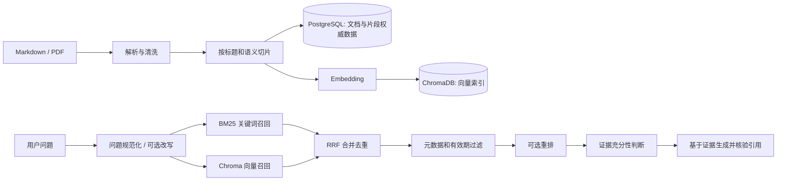

# MallMate RAG 工程落地任务计划

> 目标：在现有 MallMate 后端上，把“整篇 Markdown 的 BM25 基线”逐步升级为可导入 Markdown/PDF、可做片段级混合检索、可返回可追溯证据的售后知识 RAG。
>
> 计划遵循小步实现、每阶段可单独验收的方式。下面列出的新文件是计划新增项；已有文件标注为修改项。文档只规划实现，不代表这些能力已经完成。

## 1. 项目现状和本计划的技术决策

### 1.1 当前现状

- `backend/app/retrieval/lexical.py` 已有无需模型服务的中文 BM25 基线，但索引对象是整篇文档。
- `backend/app/services/knowledge.py` 每次查询读取全部有效文档，只返回 BM25 第一名的整篇内容。
- `knowledge/policies/*.md` 有 15 篇带简易 YAML Front Matter 的售后知识文档。
- `evals/datasets/retrieval_dev.jsonl` 和 `retrieval_holdout.jsonl` 以文档 ID 标注相关性；`evals/runner.py` 可计算文档级 Recall@5、MRR、NDCG@5。
- Docker Compose 已有 PostgreSQL、ChromaDB、MinIO；`backend/app/core/config.py` 已预留模型与服务连接参数，但向量检索、重排和 PDF 导入尚未接入业务。
- `backend/app/agent/nodes.py` 的 FAQ 节点目前直接返回一篇检索到的文档内容，没有模型生成和引用核验。

### 1.2 固定的首期架构选择

1. **PostgreSQL 是知识元数据与原文片段的权威存储。** 新增 `knowledge_chunks` 表，保存片段正文、来源、版本、有效期、标题路径、解析版本和哈希。
2. **ChromaDB 只作为可重建的向量索引。** PostgreSQL 保存的 `chunk_id` 是关联键；ChromaDB 不作为政策版本或原文的唯一来源。
3. **首期混合检索采用现有 BM25 + ChromaDB Dense Search + RRF。** 不同时再把向量写入 pgvector，避免维护两套向量索引。PostgreSQL 仍然可以作为后续关键词索引的升级目标。
4. **先做文本片段向量。** MinerU 提取的图片先生成 OCR/视觉文字描述，作为有来源关联的文本证据参与检索。跨模态图片 Embedding 是后续可选阶段，不阻塞第一版文本和 PDF RAG。
5. **MinerU 是离线导入工具，不进入聊天请求链路。** Markdown 直接解析；复杂 PDF 才调用 MinerU。其大型依赖和模型文件放独立环境或容器，避免污染 FastAPI 运行依赖。
6. **模型调用由开关控制。** 关闭模型或缺少 API Key 时，离线 BM25 和评估仍可用；不得在导入命令里静默产生模型费用。
7. **不实现 GraphRAG。** 当前售后知识主要是政策问答和适用范围过滤，优先完成高质量切片、混合召回和引用。只有出现明确的跨文档多跳查询需求后再评估知识图谱。



## 2. 任务总览

按依赖关系执行，预计约 15～20 个有效开发日；每日约 4～6 小时。模型调用和 MinerU GPU 运行时间不计入固定承诺，遇到依赖或解析质量问题时先验收当前阶段，再进入下一阶段。

| 阶段 | 任务 | 主要交付 | 验收重点 |
|---|---|---|---|
| 0 | 固化片段级评估基线 | 片段级 dev/holdout 数据和 RAG 评估入口 | 旧评估可运行；新评估能指出检索失败样例 |
| 1 | 片段模型、Markdown 切片与元数据 | 数据迁移、可重复导入、片段预览 | 文档变化能增量更新；来源和版本可追踪 |
| 2 | MinerU PDF 导入 | 可选 PDF 解析适配器和解析报告 | 复杂 PDF 的标题、表格、图片抽查通过 |
| 3 | Embedding、Chroma 向量检索、RRF | 向量索引、Dense Search、混合召回 | 可比较 BM25 / Dense / Hybrid 指标 |
| 4 | 重排与查询改写 | 可开关的 reranker 和 query rewrite | 在开发集上分别测出各组件增益与成本 |
| 5 | 证据约束回答与引用 | FAQ 生成、引用核验、证据不足降级 | 无证据不编造；引用只来自本轮召回 |
| 6 | 全链路评估、运行手册与迭代 | 报告、故障清单、导入/重建操作文档 | 新环境可重建索引且指标可复现 |

## 3. 阶段 0：先建立片段级评估基线

**预计：1～2 天。** 先保存现有文档级评估结果，不要直接把旧标签改成片段标签。切片后，一个正确文档可能对应多个片段，必须重新标注相关 `chunk_id`。

### 实施步骤

1. 备份当前开发集与留出集格式，记录旧 BM25 的指标和失败用例。
2. 新建片段级数据集，标注 `relevant_chunk_ids`，并保留 `relevant_document_ids` 方便文档级对照。
3. 每条查询覆盖精确词、口语同义表达、政策期限、商品例外、表格信息、无答案问题等类型。
4. 开发集先用于日常调整；留出集标注完成后冻结，阶段验收或版本冻结后再运行，不能拿留出集反复调参数。
5. 当前 24 条开发和 12 条留出是合成管线样例，不足以证明真实效果。建议先扩充到至少 40 条 dev、20 条 holdout；以后用脱敏客服问题替换一部分合成问法并由人工复核。

### 文件清单

| 路径 | 操作 | 职责 |
|---|---|---|
| `evals/datasets/retrieval_dev.jsonl` | 保留，必要时补元信息 | 保持现有整篇文档基线，便于和新方案对照 |
| `evals/datasets/retrieval_holdout.jsonl` | 保留并冻结 | 保持旧留出集，不用于日常调参 |
| `evals/datasets/rag_retrieval_dev.jsonl` | 新增 | 片段级开发集；记录查询、相关文档、相关片段、场景和过滤条件 |
| `evals/datasets/rag_retrieval_holdout.jsonl` | 新增 | 片段级冻结留出集；与开发集分组去重，避免同义改写泄漏 |
| `evals/rag_schema.md` | 新增 | 解释字段、标注规则、相关性判定和数据版本 |
| `evals/rag_runner.py` | 新增 | 独立评估 lexical/dense/hybrid/rerank 策略，不破坏旧评估入口 |
| `evals/metrics.py` | 修改 | 若有需要，增加可复用的命中率、Recall@K、MRR、NDCG 汇总；保持现有函数兼容 |
| `evals/reports/rag-baseline-dev.json` | 生成产物 | 保存新切片和 BM25 片段检索的首份开发集报告 |

### 数据行示例

```json
{"case_id":"rag-dev-001","query":"拆开包装后还能退吗","scenario":"return_policy","relevant_document_ids":["policy_seven_day_return"],"relevant_chunk_ids":["policy_seven_day_return:v1:0003"],"filters":{"category":"return_policy"},"answerable":true}
```

### 完成标准

- 现有 `evals/runner.py --split dev` 的数据和报告口径未被破坏。
- 新评估能输出每个查询的 Top-K 片段 ID、Recall@K、MRR、NDCG 和失败详情。
- 查询、正确片段、政策版本都可以人工复核。

### 需要理解

相关性标签、开发集/留出集、数据泄漏、Recall@K、MRR、NDCG。指标只衡量检索排序，不等价于最终答案正确率。

## 4. 阶段 1：增加片段模型和 Markdown 导入

**预计：3～4 天。** 先让 Markdown 知识具备稳定片段 ID 和完整来源；后续 PDF 与模型向量都使用这套片段契约。

### 4.1 片段数据模型

给 `KnowledgeChunk` 增加至少以下字段：

| 字段 | 用途 |
|---|---|
| `id` / `chunk_id` | 数据库主键和稳定业务 ID，如 `policy_id:version:0003` |
| `document_id` | 外键指向 `knowledge_documents` |
| `ordinal` | 片段在文档中的顺序 |
| `title_path` | 文档标题路径，如 `退换货政策 > 七日无理由退货 > 商品例外` |
| `content` | 可检索片段正文，必要时前置标题路径 |
| `content_hash` | 判断相同版本内容是否变化，支持增量导入 |
| `source_page` / `source_anchor` | PDF 页码或 Markdown 标题锚点，便于引用回源 |
| `category`、`effective_from`、`effective_to`、`scope_json` | 用于检索时过滤知识类别、生效时间、商品/地区范围 |
| `metadata_json` | 其他低频扩展元数据；过滤常用字段不要只藏在 JSON 中 |
| `chunker_version` | 记录切片算法版本，便于重建和对比 |
| `status` | active / superseded 等受控状态 |
| `parent_chunk_id` | 可选父片段 ID，为后续小片段召回、扩展上下文预留 |

向量不存入这个表；向量由 Chroma 保存。数据库的 chunk ID 与 Chroma ID 必须一致。

### 4.2 Markdown 切片规则

1. 读取现有 Front Matter，沿用 `id`、`title`、`category`、`version`、`status`。
2. 按 `#`、`##` 标题建立章节路径；较长章节再按段落边界分片，不从句子中间截断。
3. 初始长度从约 300～600 个中文字符或按 Token 上限选择一个保守值；每片可有少量相邻上下文重叠。不要把某一篇技术材料给出的 token 数当成普适标准，后续以评估集对比。
4. 片段前写入标题路径作为上下文锚点，引用时仍保留原始正文和来源。
5. 表格作为原子块优先保留表头；过长时按完整数据行分组，每个子表重复表头。
6. 空章节、重复页眉、孤立编号等噪声要报告或清理，不得静默吞掉重要政策条款。
7. 片段 ID 基于文档 ID、知识版本与顺序生成；同版本重新导入内容一致时应幂等，不应重复插入。

### 文件清单

| 路径 | 操作 | 职责 |
|---|---|---|
| `backend/app/models.py` | 修改 | 新增 `KnowledgeChunk` ORM 模型和必要索引/约束 |
| `backend/alembic/versions/<新 revision>_knowledge_chunks.py` | 新增 | 创建片段表、外键、唯一约束和索引；不改旧 revision |
| `backend/app/rag/__init__.py` | 新增 | 声明 RAG 包 |
| `backend/app/rag/schemas.py` | 新增 | 定义解析文档、知识片段、来源元数据和检索候选的数据结构 |
| `backend/app/rag/parsers/markdown.py` | 新增 | 解析 Front Matter、标题、段落、表格和图片链接 |
| `backend/app/rag/chunking.py` | 新增 | 标题路径解析、语义边界切片、长度控制、稳定 chunk ID 生成 |
| `backend/app/repositories/knowledge.py` | 修改 | 增加片段 upsert、按状态和元数据筛选、按 ID 批量取正文；保留原文档查询 |
| `backend/app/rag/ingest.py` | 新增 | 编排解析、清洗、切片、哈希、数据库写入和导入报告 |
| `backend/app/rag/cli.py` | 新增 | CLI 入口，支持 dry-run、导入目录、单文件、索引检查和重建；不由 FastAPI 启动时自动触发 |
| `backend/app/bootstrap/seed.py` | 修改 | 仅在确有必要时保持 demo 文档同步；不再把生产知识导入逻辑塞进种子流程 |
| `backend/app/core/config.py` | 修改 | 增加切片长度、重叠比例、导入输入目录等配置；为配置提供合理默认值 |
| `evals/rag_runner.py` | 修改 | 增加对切片模块离线评估的调用方式，避免必须启动数据库 |

### CLI 预期用法

```powershell
cd backend
..\.venv\Scripts\python.exe -m app.rag.cli ingest --source ..\knowledge\policies --dry-run
..\.venv\Scripts\python.exe -m app.rag.cli ingest --source ..\knowledge\policies
```

脚本首次可先输出 JSON/Markdown 导入报告，不要立即接入在线聊天。验收后再允许写库与建立向量索引。

### 完成标准

- 15 篇现有 Markdown 可以重复导入，第二次导入不产生重复片段。
- 任一片段能反查文档 ID、版本、标题路径和来源。
- 文档内容变化时能识别变化并报告新增、更新、下线片段数量。
- 用同一评估集比较“整篇文档 BM25”和“片段 BM25”，记录指标与错例。

## 5. 阶段 2：为复杂 PDF 增加 MinerU 解析

**预计：2～3 天。** 仅处理确实有双栏、扫描页、复杂表格或图片的 PDF。普通文本 PDF 先使用简单解析；Markdown 不经过 MinerU。

### 实施步骤

1. 选择 3～5 份结构不同的 PDF 作为样本：文本型、双栏、表格型、扫描/图片型。
2. 先在 F 盘独立环境或单独容器安装和运行 MinerU，评估安装、模型下载、GPU/CPU 速度和磁盘占用；不把 MinerU 全套依赖放进 `backend/pyproject.toml`。
3. 将输入 PDF、MinerU Markdown、图片资产、布局 JSON 和处理报告分开放置于被 `.gitignore` 忽略的项目数据目录，例如 `data/knowledge_import/<document_id>/<version>/`。
4. 保存原始文件哈希、解析工具版本、完成时间、输出文件哈希和错误日志。
5. 清理页眉页脚、重复页码和解析噪声；抽查标题顺序、表格行列和图片链接。MinerU 输出需要人工抽查，不能假设每个版面都解析正确。
6. 把清洗后的 Markdown 交给阶段 1 的统一切片器，确保 PDF 与 Markdown 最终使用同一套 chunk schema。
7. 对 PDF 图片记录原始对象/本地资产位置、页码和附近标题。第一版可调用视觉模型生成描述文本；关闭模型时保留图片引用并在报告标为“待补描述”。

### 文件清单

| 路径 | 操作 | 职责 |
|---|---|---|
| `backend/app/rag/parsers/base.py` | 新增 | 定义统一解析器输入输出协议，避免切片器依赖具体工具 |
| `backend/app/rag/parsers/mineru.py` | 新增 | 读取 MinerU 已生成产物、关联图片和布局信息；不在 API 请求中启动 MinerU |
| `backend/app/rag/ingest.py` | 修改 | 根据文件类型选 Markdown/PDF 解析器，并记录解析器和文档版本 |
| `backend/app/rag/cli.py` | 修改 | 支持 PDF 输入、dry-run、解析目录、错误报告和单文件重跑 |
| `scripts/run-mineru.ps1` | 新增 | 在 Windows 本机启动独立 MinerU 环境/命令；路径固定在 F 盘并记录安装说明 |
| `infrastructure/mineru/README.md` | 新增 | 记录 MinerU 环境隔离、模型目录、GPU/CPU 运行方式、数据目录和常见故障 |
| `.gitignore` | 修改 | 忽略 MinerU 模型、PDF 中间产物、解析图片缓存等大文件，但不忽略必要的小型评估样例 |
| `evals/datasets/rag_retrieval_dev.jsonl` | 修改 | 增加 PDF 页码、图片说明、表格内容的查询样例及对应 chunk ID |

### 完成标准

- 选定 PDF 可重复解析，失败能定位到文件和页码。
- 解析 Markdown 中的标题、表格和图片能对应原始页码或资产。
- 表格切片保留列名；图片描述若由模型生成，需标明“模型辅助描述”，不作为售后裁决。
- MinerU 的环境或模型缺失不影响 FastAPI、BM25 和已有评估启动。

## 6. 阶段 3：Embedding、ChromaDB 和 RRF 混合召回

**预计：3～4 天。** 在已有片段和评估集稳定后再引入 API 调用及 ChromaDB。

### 实施步骤

1. 在 `QwenGateway` 中封装 `embed_documents` 和 `embed_query`，模型调用设置批量大小、超时、有限重试和明确错误类型。
2. 用同一 Embedding 模型、同一向量维度生成文档向量和查询向量；模型名、向量维度、归一化方式作为索引版本信息保存。
3. Chroma collection 名称包含知识库/Embedding 版本，或 metadata 中有 `embedding_model` 和 `index_version`；换模型时创建新索引、评估后切换，不能把不同维度或不同模型的向量混到一处。
4. 使用 `chunk_id` 为 Chroma ID，写入向量、文本和低基数过滤 metadata；不要存 API Key 或用户附件私有访问链接。
5. 实现增量 upsert、按 document/version 删除或失效、全量重建和孤儿检查。数据库提交成功但 Chroma 写入失败时，应生成待重试的索引任务/报告，避免误报导入成功。
6. 查询时 BM25 和 Dense Search 分别召回候选（初始可各取 20），并行化留到客户端能力确定后再做；先保障结果和错误可解释。
7. 用 RRF 按排名融合并按 `chunk_id` 去重，初始 `k=60` 可作为实验起点，不是必须常量。筛选草稿、失效、过期和不适用商品/地区的片段。
8. 用同一 dev 集输出 lexical、dense、hybrid 三组指标及逐 query 排名差异，分析混合检索是否真正提高召回。

### 文件清单

| 路径 | 操作 | 职责 |
|---|---|---|
| `backend/app/core/config.py` | 修改 | 增加 Chroma 集合版本、Embedding 批量大小、RAG Top-K、向量功能开关等配置 |
| `backend/.env.example` | 修改 | 写明上述非秘密配置和开关；示例不包含真实 API Key |
| `compose.yaml` | 修改（必要时） | 确保后端依赖 Chroma 健康检查；保持现有 F 盘 `data/chroma` 数据卷 |
| `backend/pyproject.toml` | 修改 | 增加锁定兼容范围的 Chroma 客户端依赖 |
| `backend/app/integrations/qwen.py` | 修改 | 添加 Embedding 适配方法、输入/输出校验和脱敏异常映射 |
| `backend/app/rag/embeddings.py` | 新增 | 提供模型无关 Embedding 接口，便于离线 fake 与将来替换供应商 |
| `backend/app/rag/vector_store.py` | 新增 | 封装 Chroma connect、upsert、query、delete、collection version 和重建 |
| `backend/app/rag/fusion.py` | 新增 | 实现 RRF、按 chunk ID 去重和融合分数/排名记录 |
| `backend/app/rag/retriever.py` | 新增 | 编排 BM25 与向量召回、元数据过滤及 RRF 输出 |
| `backend/app/repositories/knowledge.py` | 修改 | 按一批 chunk IDs 取权威正文和状态；不得相信 Chroma 返回正文就是权威内容 |
| `backend/app/services/knowledge.py` | 修改 | 调用统一 Retriever；保留 lexical-only 降级和策略参数 |
| `backend/app/api/dependencies.py` | 修改 | 装配向量库/Embedding 适配器；使用应用生命周期共享客户端，避免每次请求新建连接 |
| `backend/app/main.py` | 修改 | 在 lifespan 管理 Chroma 客户端生命周期和健康状态，不要在模块导入时产生外部请求 |
| `evals/rag_runner.py` | 修改 | 支持 `lexical`、`dense`、`hybrid` 策略，输出召回结果和模型/索引版本 |

### 完成标准

- 关闭 LLM 时现有 BM25 可正常使用；向量服务不可用时根据配置回退 lexical 或返回可观测错误，不伪装成正常 Hybrid 结果。
- 同一 chunk 可以通过 PostgreSQL 查到，且其 Chroma ID 对应一致。
- 过期/草稿/商品范围不匹配的知识不能进入最终候选。
- dev 评估报告并列比较 lexical、dense、hybrid；每个失败用例附 Top-K ID 和过滤原因。

## 7. 阶段 4：重排和 Query Rewrite

**预计：2～3 天。** 两个功能分别开关、分别评估；不要一次同时改 Embedding、切片、改写和重排，否则无法判断收益来源。

### 重排实施

1. 把 RRF 后较小的一组候选（初始 10～20 条）送到 reranker，输出候选 chunk ID 与相关性分数。
2. 最终传给生成器的片段初始取 3～5 条；以开发集上引用正确率、上下文长度和时延调整。
3. Reranker 不负责事实判断或政策裁决，只负责对“问题与候选片段的相关程度”排序。
4. 超时/限流时可回退到 RRF 排序，但在轨迹中标注 `rerank_skipped` 和原因。

### Query Rewrite 实施

1. 先实现保守的规则规范化（空白、常见别名、术语词典）；再加可选 Qwen 改写。
2. 改写输出必须是结构化查询列表，并保留原始查询；限制最多 2～3 个子查询，避免成本和候选膨胀。
3. 订单号、SKU、型号、错误码、金额、日期、政策期限等精确实体必须保留，禁止改写成另一个值。
4. 多个查询的召回结果按 chunk ID 合并，再做一次 RRF；评估原始 query 和 rewrite 两种策略。
5. Query Rewrite 默认关闭，只有评测证明某类问法改善后才按场景启用。

### 文件清单

| 路径 | 操作 | 职责 |
|---|---|---|
| `backend/app/rag/reranker.py` | 新增 | Reranker 协议、候选重排、超时和 lexical/RRF 降级 |
| `backend/app/rag/query_rewrite.py` | 新增 | 规则术语扩展、可选模型改写、结构化结果和实体保留校验 |
| `backend/app/integrations/qwen.py` | 修改 | 如果百炼 Rerank API 与 OpenAI 兼容接口不同，则单独封装对应协议，不复用错误的 chat 请求格式 |
| `backend/app/core/config.py` | 修改 | 增加 rewrite/rerank 启用开关、候选数、超时、输出数配置 |
| `backend/.env.example` | 修改 | 明确默认关闭及配置说明 |
| `backend/app/rag/retriever.py` | 修改 | 让 rewrite、RRF 和 rerank 可按策略单独组合 |
| `evals/rag_runner.py` | 修改 | 增加 hybrid+rewrite、hybrid+rerank、完整组合的对照实验 |
| `evals/reports/` | 生成产物 | 记录指标、调用次数、延迟和失败样例，报告不要只写单个总分 |

### 完成标准

- 能分别比较“无改写/有改写”和“无重排/有重排”，报告中保存配置与版本。
- 精确实体在 Query Rewrite 后保持不变。
- 重排超时不会导致整个 FAQ 崩溃；降级路径能被日志和指标识别。
- 若某组件使指标无提升或代价明显过高，保持默认关闭并记录结论。

## 8. 阶段 5：证据约束的回答和引用

**预计：2～3 天。** 先给 API/Agent 定义稳定 Evidence 结构，再接对话模型；订单和售后事实仍由现有服务及领域规则提供。

### Evidence 契约

每条证据至少包含：

```json
{
  "chunk_id": "policy_seven_day_return:v1:0003",
  "document_id": "policy_seven_day_return",
  "title": "七日无理由退货",
  "title_path": ["退货政策", "适用范围"],
  "source_uri": "knowledge/policies/01-seven-day-return.md",
  "source_page": null,
  "version": "v1",
  "effective_from": "2026-01-01",
  "effective_to": null,
  "content": "...",
  "retrieval_rank": 1
}
```

客户端展示用的来源不一定展示内部检索分数，但后端轨迹应保存 chunk ID、策略名和名次以便排查。

### 实施步骤

1. `KnowledgeService.search` 返回多条 `KnowledgeEvidence`，而不是单篇全文；正文由 PostgreSQL 按 chunk ID 加载。
2. FAQ 节点把用户问题、有限数量的证据和“证据不足时说明无法确认”的指令传给对话模型。
3. 生成内容可以引用 `chunk_id`；服务端校验引用 ID 属于本轮提供的证据，禁止模型捏造引用。
4. 引用显示文档标题、标题路径、版本和页码/来源锚点；政策版本和有效期先由检索过滤器判定。
5. 证据为空或不足时不调用生成，直接追问或转人工。不要只靠模型自评置信度决定是否能回答。
6. 检索到的知识文档视为不可信数据，文档中的指令不能改变身份、权限、工具调用和业务规则。
7. API 仍保持 `/api/v1/chat` 路径；扩展 `SourceResponse`，避免把复杂 Evidence 对象直接暴露为无约束 dict。

### 文件清单

| 路径 | 操作 | 职责 |
|---|---|---|
| `backend/app/services/knowledge.py` | 修改 | 返回多条片段证据和检索策略信息；执行证据充分性前置检查 |
| `backend/app/agent/state.py` | 修改 | 增加类型明确的 `retrieved_evidence`，仅保存本轮必要的可序列化证据摘要 |
| `backend/app/agent/nodes.py` | 修改 | FAQ 节点调用检索后生成答案、核验引用；无证据时安全降级 |
| `backend/app/agent/graph.py` | 修改 | 如需拆节点，增加 retrieve、check_evidence、compose_answer 条件边；保持图职责清楚 |
| `backend/app/schemas/common.py` | 修改 | 明确来源响应字段，如 document/chunk ID、title、version、URI/page |
| `backend/app/schemas/chat.py` | 修改 | 保持 ChatResponse.sources 使用显式 SourceResponse 类型 |
| `backend/app/integrations/qwen.py` | 修改 | 添加 FAQ 生成调用，区分 chat/embedding/rerank/vision 任务，统一 timeout 和错误处理 |
| `backend/app/core/config.py` | 修改 | 增加证据阈值/最少相关片段等保守参数；具体阈值由 dev 集校准 |
| `evals/datasets/rag_answer_dev.jsonl` | 新增 | 标注答案要点、允许引用 ID、不可回答场景和预期追问/转人工 |
| `evals/rag_runner.py` | 修改 | 验证引用存在性、引用支持度、无证据拒答与回答事实边界 |

### 完成标准

- FAQ 回答能附带来源，来源包含真实文档版本与片段定位。
- 伪造 chunk ID、过期政策、空召回等场景不能返回看似有引用的答案。
- 证据不足时稳定进入追问或人工路径。
- 查询订单、售后资格等事实仍分别经过 OrderService 和售后领域服务，不被 RAG 或模型替代。

## 9. 阶段 6：索引维护、观测与上线前验收

**预计：2～3 天，和前面阶段交叉进行。**

### 文件清单

| 路径 | 操作 | 职责 |
|---|---|---|
| `backend/app/rag/index_jobs.py` | 新增 | 定义待写入/待删除索引任务及重试状态；首版可由导入 CLI 同步执行并生成失败清单 |
| `backend/app/observability/metrics.py` | 修改 | 增加低基数 RAG 指标：召回策略、各阶段延迟、空召回、降级、模型调用失败；不使用 query/user/chunk ID 作 Prometheus 标签 |
| `evals/rag_runner.py` | 修改 | 报告代码、知识、切片、Embedding、Prompt 和模型版本，以及每条失败阶段 |
| `evals/rag_schema.md` | 修改 | 记录标注规则、数据版本和指标定义 |
| `docs/业务规则与评估数据说明.md` | 修改 | 更新哪些 RAG 能力已接入、数据规模、模型配置和未完成边界 |
| `docs/后端工程架构.md` | 修改 | 补充 rag 包、解析导入、索引存储及 Evidence 的调用关系 |
| `docs/开发记录.md` | 修改 | 逐阶段记录命令、指标、错误和决定 |
| `README.md` | 修改 | 添加知识导入、向量重建、RAG 评估命令及服务要求 |

### 完成标准

- PostgreSQL 有效文档/片段是权威数据；删除或更新文档后 Chroma 索引可一致更新或重建。
- 数据库成功、Chroma 失败或模型超时三种状态都有可观察且可恢复的处理方式。
- Prometheus 只记录聚合指标；详细 query 和候选轨迹可写受控日志/评估报告并脱敏。
- README 可以从空 Chroma collection 重新导入知识并复现开发集评估。

## 10. 建议的开发顺序和阶段验收命令

以下是实施后的目标命令，尚未创建相关 CLI 前不要直接执行：

```powershell
# 先跑现有基线，保留对照报告
& .\.venv\Scripts\python.exe .\evals\runner.py --split dev

# Markdown 解析与切片预览，不写数据库/Chroma
& .\.venv\Scripts\python.exe -m app.rag.cli ingest --source ..\knowledge\policies --dry-run

# 正式导入 Postgres 并写 Chroma
& .\.venv\Scripts\python.exe -m app.rag.cli ingest --source ..\knowledge\policies

# 检查索引对账，必要时重建
& .\.venv\Scripts\python.exe -m app.rag.cli index-check
& .\.venv\Scripts\python.exe -m app.rag.cli index-rebuild --collection mallmate_knowledge_v1

# 只在开发集上比较不同策略
& .\.venv\Scripts\python.exe .\evals\rag_runner.py --split dev --strategy all
```

`app.rag.cli` 和 `rag_runner.py` 参数属于计划接口，正式实现时以实际 CLI 为准。留出集只在版本冻结后执行。

## 11. 文件变更总表

### 计划新增

```text
backend/app/rag/__init__.py
backend/app/rag/schemas.py
backend/app/rag/chunking.py
backend/app/rag/ingest.py
backend/app/rag/cli.py
backend/app/rag/parsers/__init__.py
backend/app/rag/parsers/base.py
backend/app/rag/parsers/markdown.py
backend/app/rag/parsers/mineru.py
backend/app/rag/embeddings.py
backend/app/rag/vector_store.py
backend/app/rag/fusion.py
backend/app/rag/retriever.py
backend/app/rag/reranker.py
backend/app/rag/query_rewrite.py
backend/app/rag/index_jobs.py
backend/alembic/versions/<新 revision>_knowledge_chunks.py
evals/datasets/rag_retrieval_dev.jsonl
evals/datasets/rag_retrieval_holdout.jsonl
evals/datasets/rag_answer_dev.jsonl
evals/rag_schema.md
evals/rag_runner.py
backend/tests/rag/test_chunking.py
backend/tests/rag/test_fusion.py
backend/tests/rag/test_retriever.py
backend/tests/rag/test_citations.py
scripts/run-mineru.ps1
infrastructure/mineru/README.md
```

### 计划修改

```text
backend/app/models.py
backend/app/repositories/knowledge.py
backend/app/services/knowledge.py
backend/app/core/config.py
backend/app/integrations/qwen.py
backend/app/api/dependencies.py
backend/app/main.py
backend/app/agent/state.py
backend/app/agent/nodes.py
backend/app/agent/graph.py
backend/app/schemas/common.py
backend/app/schemas/chat.py
backend/app/observability/metrics.py
backend/pyproject.toml
backend/.env.example
compose.yaml
.gitignore
evals/metrics.py
evals/datasets/retrieval_dev.jsonl (仅保留兼容格式时才扩展)
docs/业务规则与评估数据说明.md
docs/后端工程架构.md
docs/开发记录.md
README.md
```

## 12. 第一版明确不做的内容

- 不做 GraphRAG、复杂知识图谱和自动本体构建。
- 不一次性支持所有文件格式；先 Markdown，再选定 PDF；Office/网页等按真实需求增加。
- 不把 MinerU、OCR、向量化、重排放进用户同步聊天请求。
- 不对用户上传的售后凭证默认做知识库索引；私有附件属于案件证据，与公共政策知识隔离。
- 不让视觉模型判定赔付资格，不让 RAG 覆盖订单数据库或 `after_sales_policy.py` 的业务裁决。
- 不用一份合成数据评测报告宣称线上准确率；最终效果要用脱敏、人工复核的问题样本验证。
