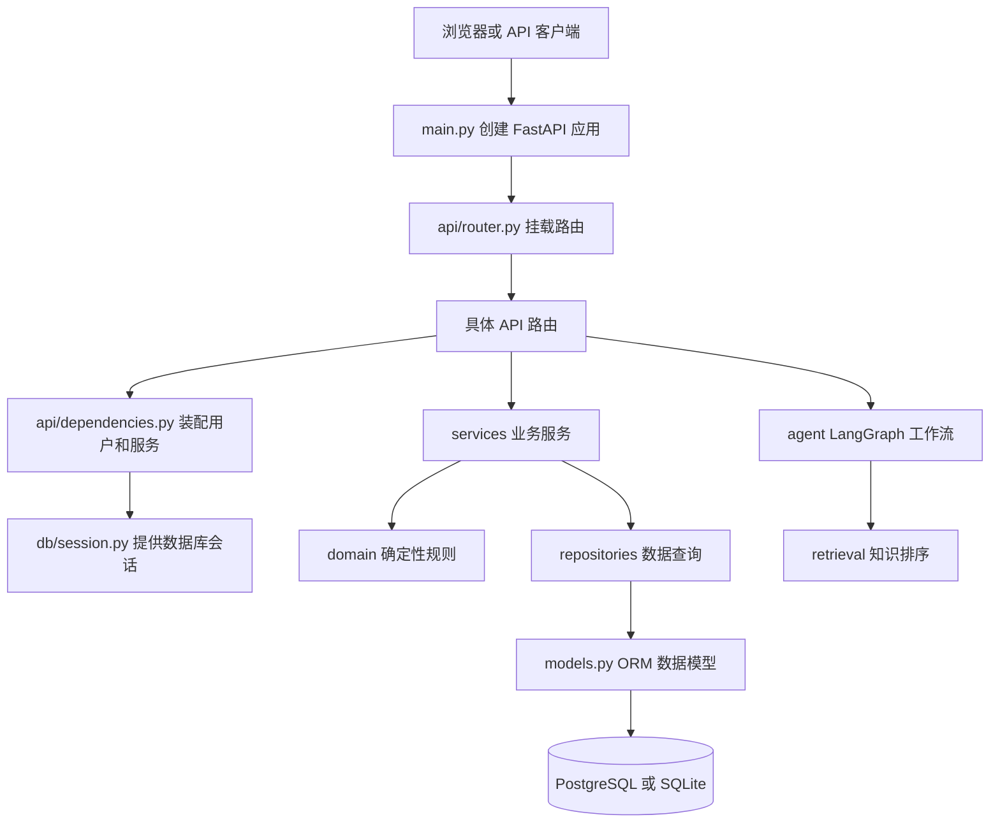

# MallMate 代码阅读与技术学习路线

这份路线按“先看得懂系统，再顺着一条请求读代码，最后学习 Agent 和基础设施”的顺序安排。不要按文件名从上往下通读；每次只跟一条业务链路，边读边画调用关系。

## 阅读方法

每个阶段按下面四步进行：

1. 先看本阶段的流程图和问题，尝试用自己的话回答。
2. 按表格里的顺序读文件。遇到函数调用，用 IDE 的“转到定义”跟到下一层。
3. 在纸上或 Markdown 里画出“输入从哪里来、经过哪些函数、数据从哪里来、结果返回到哪里”。
4. 不看代码，口头复述一次；再打开代码核对。复述不出来时只回到当前链路，不要跳去读其他模块。

推荐每次学习 45～90 分钟。先理解“这段代码为什么存在”，再记 FastAPI、SQLAlchemy 等术语。

## 项目调用关系总览



这张图描述的是模块依赖，不代表每个请求都会经过所有模块。订单查询不经过 LangGraph；聊天请求会经过 LangGraph；售后预览会经过业务服务和规则模块。

## 第 0 阶段：先建立整体认识

**目标：**知道项目有哪些能力、当前哪些能运行、哪些只是配置或预留。

阅读顺序：

1. `README.md`
2. `docs/后端工程架构.md`
3. `docs/业务规则与评估数据说明.md`
4. `docs/后续开发清单.md`

学习知识：项目目录、模块边界、运行时依赖与“已实现/待接入”的区别。

读完应该能回答：

- 浏览器、FastAPI、数据库、LangGraph 分别负责什么？
- 哪些外部服务已经写入 Docker Compose，哪些还没有进入应用业务流程？
- 为什么真实订单状态不能由语言模型自行编造？

**先记住一个边界：**项目虽然配置了 Redis、ChromaDB、MinIO 和通义千问，但当前代码没有把它们完整接入 Agent 工作流。读代码时要把“容器已配置”和“业务已使用”分开判断。

## 第 1 阶段：Python 和 Web 的最小基础

如果下面概念不熟，先花少量时间补齐，不必先学完整课程：

| 概念 | 在项目中的例子 | 需要理解什么 |
|---|---|---|
| 函数、参数、返回值 | `get_order_data(customer_id, order_id)` | 输入与输出如何传递 |
| 类与对象 | `OrderService(...)` | 对象保存什么依赖、方法如何使用依赖 |
| 类型注解 | `Session → OrderService` | 类型提示帮助阅读和检查，不会自动运行所有规则 |
| 列表、字典、集合 | API 返回数据、状态字段 | JSON 数据通常如何在 Python 中表示 |
| 异常 | `ResourceNotFoundError` | 错误如何从底层传到 HTTP 响应 |
| 装饰器 | `@router.get(...)` | 框架如何读取函数并注册 API |
| `yield` | `get_db()` | 产生数据库会话，并在请求结束时清理 |

建议只对照项目例子学习，不必先读完 Python 语法书。

## 第 2 阶段：应用如何启动

按顺序阅读：

1. `scripts/start-backend.ps1`：启动命令和工作目录。
2. `backend/app/main.py`：创建 FastAPI、注册中间件、装配路由和启动生命周期。
3. `backend/app/api/router.py`：集中挂载 API 路由。
4. `backend/app/api/routes/health.py`：最简单的 HTTP 接口。
5. `backend/app/core/config.py`：配置从哪里读取。

学习知识：HTTP 请求/响应、URL 路径、路由注册、应用生命周期、CORS 中间件、环境变量。

读完应该能回答：

- 为什么 `main.py` 要导入 `api_router`？
- `/health` 与 `/api/v1/orders/...` 的路径前缀分别在哪里决定？
- `lifespan` 在应用什么时候运行？
- CORS 解决什么浏览器访问问题？它不负责身份认证。

## 第 3 阶段：第一条完整请求链——查询订单

这是最适合初学者跟读的链路，因为它不涉及模型或复杂状态。

阅读顺序：

1. `backend/app/schemas/order.py`：API 返回数据必须长什么样。
2. `backend/app/api/routes/orders.py`：接收订单号、声明依赖、调用服务。
3. `backend/app/api/dependencies.py`：如何提供当前用户和 `OrderService`。
4. `backend/app/db/session.py`：Engine、Session 工厂和请求级数据库会话。
5. `backend/app/services/orders.py`：订单归属检查和业务输出。
6. `backend/app/repositories/orders.py`：SQLAlchemy 查询。
7. `backend/app/models.py` 中的 `Order`、`OrderItem`、`Product`：Python 对象如何对应数据库表。
8. `backend/app/api/errors.py` 与 `backend/app/core/exceptions.py`：订单不存在如何转换成 HTTP 错误。

把调用顺序画成：

```text
GET /api/v1/orders/1001
  → FastAPI 匹配 get_order
  → Depends 提供 customer 和 OrderService
  → OrderService 请求 OrderRepository
  → Repository 查询“订单号 + 当前用户 ID”
  → Service 组织结果
  → OrderResponse 校验并序列化 JSON
```

重点技术：FastAPI 依赖注入、Pydantic 响应模型、SQLAlchemy ORM、外键、关系、用户授权。

读完应该能回答：

- 为什么订单查询同时传 `customer_id` 和 `order_id`？
- 为什么用户归属检查放在 Service/Repository，而不是相信请求里的用户 ID？
- Repository 和 Service 的职责有什么不同？
- `response_model` 如何帮助约束 API 返回内容？

## 第 4 阶段：第二条请求链——物流查询

阅读 `backend/app/services/orders.py` 的 `get_logistics_data`，再跟到 `OrderRepository.get_shipment` 和 `Shipment` 模型。

学习知识：关联数据查询、空值、业务状态、先授权再访问附属资源。

关键点：即使接口要查物流，也必须先证明订单属于当前用户。不能拿到 `order_id` 就直接查物流记录。

## 第 5 阶段：售后预览和确认写入

这是理解业务系统如何安全修改数据的关键链路。

阅读顺序：

1. `backend/app/schemas/after_sales.py`：请求是否明确表达确认。
2. `backend/app/api/routes/after_sales.py`：`/preview` 和 `/confirm` 两个接口。
3. `backend/app/services/after_sales.py`：预览、复核、幂等写入、事务提交和回查。
4. `backend/app/domain/after_sales_policy.py`：纯业务规则如何给出结论。
5. `backend/app/repositories/after_sales.py`：售后单数据查询与写入。
6. `backend/app/models.py` 中的 `AfterSalesCase`：唯一约束如何保护幂等键。
7. `backend/app/api/errors.py`：业务错误如何变成 API 响应。

理解以下流程：

```text
预览：查订单归属 → 运行售后规则 → 返回结果（不写库）
确认：检查幂等键 → 重新运行规则 → 写数据库 → 提交事务 → 回查结果
```

学习知识：业务规则、事务、唯一约束、幂等、请求哈希、异常回滚、HTTP 状态码。

读完应该能回答：

- 为什么确认接口不能只相信之前的预览结果？
- 同一确认请求重复发送时，为什么不应创建两张售后单？
- `commit()`、`rollback()`、数据库唯一约束分别解决什么问题？
- 模型能建议“申请退款”，为什么仍要让后端重新核验？

## 第 6 阶段：数据从哪里来——种子和模拟数据

阅读顺序：

1. `backend/fixtures/demo_data.json`：有哪些虚构用户、订单和商品。
2. `backend/app/bootstrap/seed.py`：JSON 和 Markdown 如何导入数据库。
3. `backend/app/main.py` 的 `lifespan`：种子程序什么时候被调用。
4. `knowledge/policies/01-seven-day-return.md`：看一篇带元数据的知识文档。

学习知识：JSON、数据库初始化、重复执行安全、稳定主键、数据版本、Markdown YAML frontmatter。

读完应该能回答：

- 为什么 seed 要做到重复运行时不重复插入？
- `demo_data.json` 是业务数据还是评估数据？
- 为什么法律规则文本和代码里的自动决策规则应该一起维护版本？

## 第 7 阶段：知识问答与 BM25 检索

阅读顺序：

1. `backend/app/repositories/knowledge.py`：取得哪些知识文档。
2. `backend/app/services/knowledge.py`：知识查询服务如何组织输入输出。
3. `backend/app/retrieval/lexical.py`：分词、计算 BM25 分数和排序。
4. `backend/app/agent/nodes.py` 的 `answer_faq`：Agent 如何调用知识服务。
5. `knowledge/policies/` 中挑两篇相似文档对比。

学习知识：倒排检索概念、词频、文档频率、BM25、Top-K、来源引用、检索与生成的区别。

读完应该能回答：

- BM25 输入什么、输出什么？
- 为什么检索结果只是一批候选证据，不能直接证明所有回答都正确？
- 现在的代码是否真的使用 ChromaDB？（目前检索链使用 BM25；Compose 配置 ChromaDB 不代表向量检索已接入。）

## 第 8 阶段：LangGraph 与聊天请求

阅读顺序：

1. `backend/app/agent/intent.py`：规则分类如何产生意图和紧急度。
2. `backend/app/agent/state.py`：State 和 Context 分别保存什么。
3. `backend/app/agent/nodes.py`：每个节点做什么。
4. `backend/app/agent/graph.py`：节点和边如何组成图。
5. `backend/app/api/routes/chat.py`：FastAPI 如何调用图并保存对话。
6. `backend/app/services/conversations.py` 和 `backend/app/repositories/conversations.py`：消息如何写入数据库。

学习知识：图、节点、边、条件路由、状态、运行上下文、依赖注入、多轮会话。

读完应该能回答：

- 一条聊天消息从 API 进入后，经过哪些节点？
- `AgentState` 为什么放普通任务数据，`AgentContext` 为什么放 Service？
- `route_after_classify` 怎么决定 FAQ、订单或人工分支？
- 当前是否把历史消息传回模型？是否接了 Checkpointer？

当前图是单轮、规则分类的开发版。人工分支是提示占位；图中尚无模型生成、持久检查点、暂停确认和工单创建。了解边界能帮助你避免把计划能力误认为已经实现。

## 第 9 阶段：通义千问和外部服务适配

阅读顺序：

1. `backend/app/core/config.py` 中 `llm_*` 配置。
2. `backend/.env.example` 中的模型配置示例。
3. `backend/app/integrations/qwen.py`。

学习知识：OpenAI 兼容 API、Base URL、API Key、模型名、超时、重试、密钥管理、环境配置。

读完应该能回答：

- `QwenGateway` 目前提供了哪些能力，哪些调用还没有实现？
- 为什么 API Key 放在环境变量而不写进 Python 文件？
- 为什么不同模型任务使用独立模型配置？

本项目的 Gateway 当前主要完成客户端装配与模型目录配置，Agent 尚未调用它。不要把“能创建 SDK 客户端”误解成“Agent 已接入千问”。

## 第 10 阶段：评估不是只看一个分数

阅读顺序：

1. `evals/README.md`：数据集切分和评估边界。
2. `evals/datasets/intent_dev.jsonl`：一个意图样例的字段。
3. `evals/datasets/retrieval_dev.jsonl`：相关文档标注。
4. `evals/datasets/policy_dev.jsonl`：规则输入与期望结果。
5. `evals/metrics.py`：指标公式的代码实现。
6. `evals/runner.py`：如何加载数据、执行基线和写报告。
7. `evals/reports/offline-dev.json`：一次实际评估结果。

学习知识：训练/开发/留出数据的区别、Accuracy、Precision、Recall、F1、Recall@K、MRR、NDCG、指标门槛、数据泄漏。

建议自己手算一条简单例子：正确文档排在第1名和第4名时，MRR 分别是多少？再在报告中找到对应字段。

## 第 11 阶段：监控与 Docker

阅读顺序：

1. `backend/app/observability/metrics.py`。
2. `infrastructure/prometheus/prometheus.yml`。
3. `compose.yaml` 中 `db`、`backend`、`chroma`、`prometheus` 服务。
4. `backend/Dockerfile` 与 `frontend/Dockerfile`。
5. `.dockerignore` 和 `.gitignore`。

学习知识：容器、镜像、端口映射、卷、服务发现、健康检查、Prometheus 抓取、指标标签基数。

读完应该能回答：

- 容器之间为什么用服务名连接数据库？
- `ports` 和 `volumes` 分别解决什么问题？
- Prometheus 从哪里读取 FastAPI 指标？
- 为什么订单号不适合作为 Prometheus 标签？

## 适合初学者的两周节奏

| 学习日 | 阅读阶段 | 当天产出 |
|---:|---|---|
| 第 1 天 | 阶段 0、1 | 画一张项目模块图，写下不懂的10个词 |
| 第 2 天 | 阶段 2 | 画出应用启动流程，能说清 `/health` 怎么注册 |
| 第 3～4 天 | 阶段 3 | 画订单查询时序，解释用户归属校验 |
| 第 5 天 | 阶段 4 | 解释查物流为何先检查订单归属 |
| 第 6～7 天 | 阶段 5 | 画售后预览/确认流程，解释幂等和事务 |
| 第 8 天 | 阶段 6 | 画 JSON/Markdown 到数据库的导入流程 |
| 第 9 天 | 阶段 7 | 手工追踪一个问题如何命中文档 |
| 第 10～11 天 | 阶段 8 | 画 LangGraph 状态图并解释每条边 |
| 第 12 天 | 阶段 9 | 解释模型配置、API Key 和当前接入状态 |
| 第 13 天 | 阶段 10 | 手算 Accuracy、Recall@5、MRR 的简单例子 |
| 第 14 天 | 阶段 11 | 画 Docker 服务图并解释数据卷和端口 |

每天建议记三句话：今天看懂了什么、仍不懂什么、下次从哪个函数继续。

## 阅读时先别展开的部分

这些内容目前不是第一轮阅读的重点：

- `__init__.py` 大多只是让目录成为 Python 包。
- `.venv`、`frontend/node_modules`、`.next` 是生成或安装目录，不是业务源代码。
- `package-lock.json` 锁定前端依赖版本，知道用途即可，不需要逐行阅读。
- `.env.example` 是配置模板，不要在里面放真实密钥。
- `backend/scripts/smoke.py` 是 HTTP 冒烟流程，可在读完订单与售后链路后再看。

## 第一周结束的自测

不打开源码，尝试回答：

1. 一个 HTTP 请求怎样从 FastAPI 路由走到数据库？
2. 当前用户身份由谁提供？订单归属在哪里检查？
3. 售后预览和确认为什么是两个步骤？
4. 一次售后写入如何避免重复？
5. LangGraph 的 State、Context、Node、Edge 分别是什么？
6. 当前系统有哪些真实实现，哪些只是容器配置或未来接口？

能讲清这些问题后，再开始改代码会容易很多。
