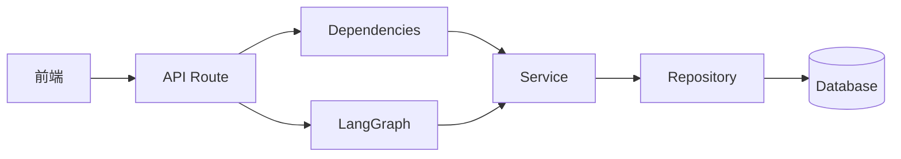

# MallMate 后端工程架构

更新日期：2026-10-12

## 1. 目标

本轮整理保持现有 `/health`、`/api/v1/chat`、订单、物流和售后接口路径兼容，把原先集中在 `main.py`、`services.py` 和 `workflow.py` 的职责拆开。目标是让后续认证、RAG、工具、检查点和工单能力可以按层接入，而不用持续扩大入口文件。

## 2. 当前目录

```text
backend/app/
  main.py                 # 创建 FastAPI，装配中间件、异常处理和路由
  core/                   # 配置、受控枚举、领域异常
  db/                     # SQLAlchemy Base、Engine、Session
  models.py               # 当前规模下集中保存 ORM 表模型
  schemas/                # 按领域拆分的 API 请求/响应模型
  repositories/           # 只负责数据库查询和持久化
  services/               # 业务规则、权限范围、事务和幂等逻辑
  domain/                 # 不依赖 FastAPI/数据库的确定性业务规则
  agent/                  # LangGraph 状态、节点和图装配
  retrieval/              # BM25 基线，后续接 ChromaDB 与 RRF
  integrations/           # 通义千问等外部服务适配器
  observability/          # Prometheus 指标，后续增加 Trace
  api/
    dependencies.py       # 把 Session、仓储、服务和当前用户装配起来
    errors.py             # 领域异常到 HTTP 状态码的统一转换
    router.py             # 汇总子路由
    routes/               # chat、orders、after_sales、health
  bootstrap/seed.py       # 仅用于开发环境的可重复演示数据初始化
backend/fixtures/         # 版本化虚构用户、商品、订单、物流和售后数据
knowledge/policies/       # 版本化 Markdown 售后知识
evals/                    # 开发集、留出集、指标、运行器和报告
```

## 3. 分层规则

| 层 | 可以做什么 | 不应做什么 |
|---|---|---|
| `api/routes` | 解析 HTTP 参数、调用服务、声明响应模型 | 写 SQL、实现资格规则、直接拼 Agent 节点 |
| `api/dependencies` | 创建请求级服务、取得当前用户 | 保存业务数据、决定售后资格 |
| `schemas` | 定义 API 数据契约和字段约束 | 查询数据库 |
| `repositories` | 编写 SQLAlchemy 查询和持久化方法 | 抛 HTTP 异常、生成客服回答 |
| `services` | 执行业务规则、授权范围、事务、幂等 | 依赖 FastAPI Request/Response |
| `domain` | 执行可复现、可单测的纯业务规则 | 访问 HTTP、数据库或模型 |
| `agent` | 管理状态、节点和条件路由 | 把模型输出当作订单事实或授权凭据 |
| `retrieval` | 排序候选知识，输出稳定文档 ID 和分数 | 直接生成最终业务结论 |
| `integrations` | 封装外部 SDK、地址、超时和模型选择 | 决定订单权限和售后资格 |
| `core` | 提供全局配置、枚举和领域异常 | 放具体业务流程 |
| `bootstrap` | 准备开发环境和演示数据 | 在生产环境自动运行 |

## 4. 请求调用链



聊天请求中，API 创建请求级的 `OrderService` 和 `KnowledgeService`，通过 `AgentContext` 注入已经编译好的 LangGraph。可持久任务数据放在 `AgentState`，数据库 Session 等不可序列化对象不进入状态，为后续 checkpointer 留出正确边界。

## 5. 事务边界

- 查询服务不提交事务。
- `ConversationService.save_exchange` 负责一轮消息的提交。
- `AfterSalesService.create` 负责资格复核、幂等查询、写入、提交和写后回查。
- 数据库唯一约束是并发幂等的最终保障，应用层预查询只用于快速返回。
- 后续增加 Unit of Work 后，把 `commit/rollback` 进一步集中，避免跨多个服务的业务操作各自提交。

## 6. 异常边界

服务层抛出 `AuthenticationError`、`ResourceNotFoundError`、`ConflictError` 和 `BusinessRuleError`。这些异常不依赖 FastAPI。`api/errors.py` 统一转换成 HTTP 401、404、409 和 422，并返回：

```json
{
  "code": "resource_not_found",
  "detail": "订单不存在"
}
```

这使同一个业务服务可以被 API、Agent 工具、后台任务或命令行脚本复用。

## 7. 为什么暂时保留单个 models.py

当前只有用户、商品、订单、物流、知识、售后和会话等少量表。继续按一个文件维护更容易理解。表数量达到约 12～15 张，或不同开发者频繁修改同一文件时，再按 `commerce`、`knowledge`、`support`、`agent` 拆成模型包。

按当前项目范围，一笔订单对应一条物流记录；多包裹和物流轨迹本轮暂不扩展。

## 8. 扩展新功能的方式

以“创建人工工单”为例：

1. 在 `models.py` 增加最小 `Ticket` 模型。
2. 在 `schemas/ticket.py` 定义请求和响应。
3. 在 `repositories/tickets.py` 实现数据库访问。
4. 在 `services/tickets.py` 实现归属、摘要和状态规则。
5. 在 `api/routes/tickets.py` 暴露 API。
6. 在 `agent/nodes.py` 增加调用工单服务的节点。
7. 在 `agent/graph.py` 注册节点和条件边。

这套顺序保证 HTTP、数据库和 Agent 的职责不会混在一起。

